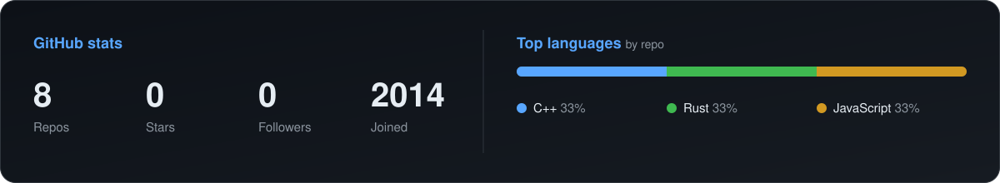

<!--
  README skin. skin/skin.mjs draws every template and theme from public GitHub data into skin/out,
  and .github/workflows/skin.yml refreshes them daily. Pick one in the README Skin Builder (index.html)
  and press Activate: it points your profile README at that template and theme.
-->

  

  

